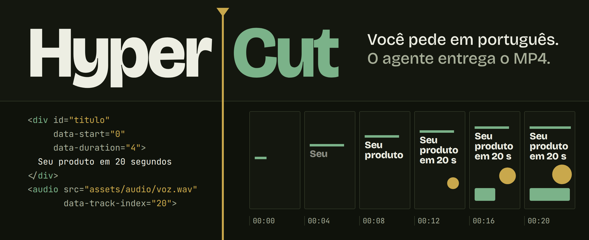
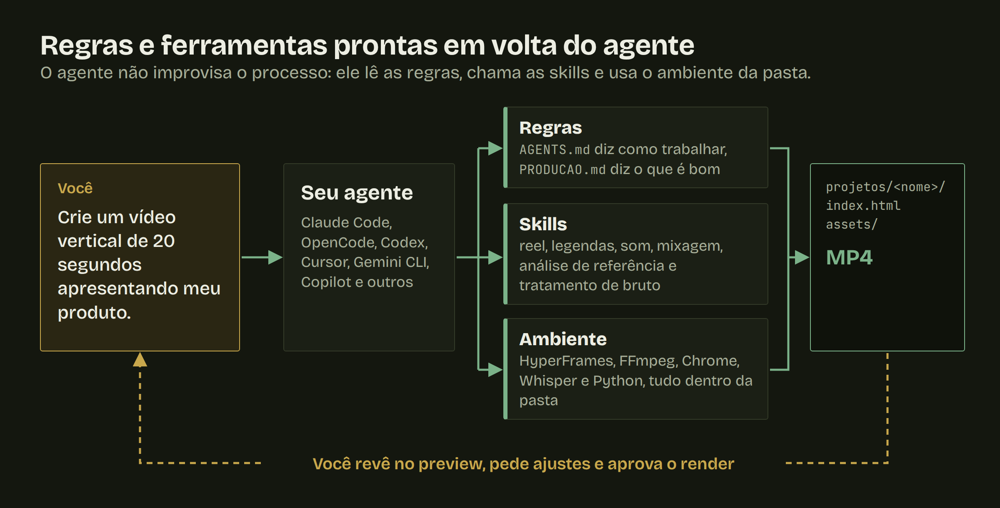
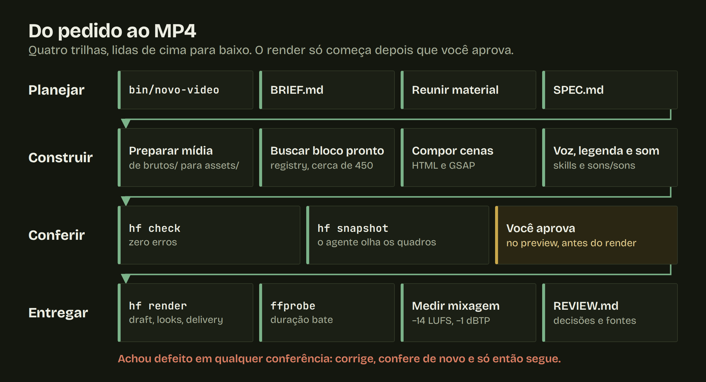
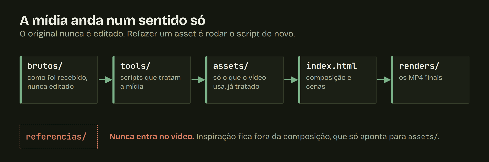
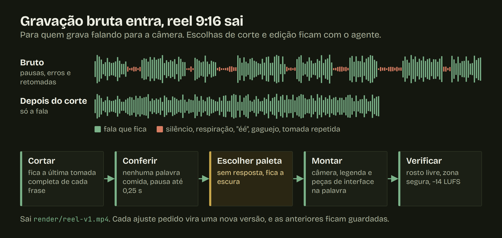
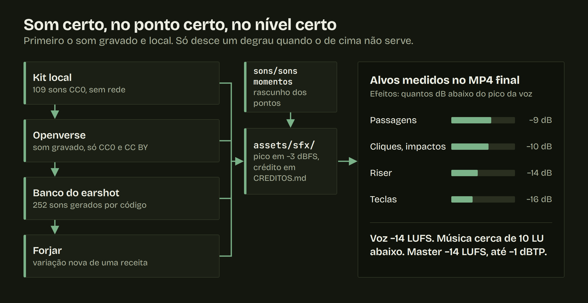

<p align="center">
  <strong>Diga o vídeo que você quer. Seu agente de IA planeja, anima, mixa, confere e entrega o MP4.</strong>
</p>

<p align="center">
  <a href="LICENSE"></a>
  <a href="https://github.com/heygen-com/hyperframes"></a>
  
</p>

<p align="center">
  <a href="#o-que-dá-para-pedir">O que dá para pedir</a> ·
  <a href="#como-funciona">Como funciona</a> ·
  <a href="#do-pedido-ao-mp4">Do pedido ao MP4</a> ·
  <a href="#agentes-compatíveis">Agentes</a> ·
  <a href="#começar">Começar</a>
</p>

HyperCut é uma área de trabalho pronta para produzir vídeo com [HyperFrames](https://github.com/heygen-com/hyperframes), que transforma HTML em MP4. Você não abre editor nem timeline: conversa com o agente que já usa, no terminal, em português.

Um agente sozinho até monta um vídeo, mas improvisa o processo. Aqui ele recebe um fluxo de produção, regras em números e ferramentas prontas. Ele planeja antes de construir, olha os quadros que gerou, espera sua aprovação e mede o áudio no arquivo final.

## O que dá para pedir

| Você pede | O agente faz |
| --- | --- |
| "Crie um vídeo vertical de 20 segundos apresentando meu produto." | Cria o projeto, planeja cena a cena, anima em HTML e renderiza depois da sua aprovação |
| "Crie um carrossel de 6 lâminas pro Instagram e pro LinkedIn" | Planeja o arco lâmina a lâmina, monta em HTML, valida fontes, contraste e zonas seguras, escreve a legenda e exporta PNG, prancha e PDF |
| "Edita esse reel" e manda a gravação | Tira pausas, erros e retomadas e monta em 9:16, com legenda e peças de interface |
| "Quero algo nesse estilo" e manda um link de vídeo ou post | Baixa ou lê a referência, gera pranchas, mede ritmo, paleta e estrutura na sua máquina |
| "Põe legenda palavra por palavra" | Gera a legenda da voz final, em blocos de 1 a 3 palavras com destaques |
| "Coloca efeitos sonoros" | Acha os pontos, escolhe o som, ajusta o nível e registra o crédito |
| "A voz tá com chiado" ou "o vídeo tá tremido" | Limpa a voz, estabiliza a imagem e confere o arquivo contra a spec da rede |
| "Mede a mixagem" | Mede voz, trilha, efeitos e master no MP4 e compara com os alvos |

## Como funciona



Todo agente lê as mesmas regras em `AGENTS.md` e `PRODUCAO.md`, e as skills seguem o formato aberto `SKILL.md`. Trocar de agente não muda o processo. Tudo o que o vídeo precisa mora nesta pasta: CLI, FFmpeg, Chrome, Whisper e Python.

## Do pedido ao MP4



Check verde não libera o render. Quem libera é você, depois de assistir ao preview. No fim, `REVIEW.md` guarda decisões, fontes e medições de cada vídeo.

Cada vídeo é um projeto isolado em `projetos/<nome>/`, e a mídia nunca volta atrás:



## Reel de gravação real

Gravou falando para a câmera? A skill `reel` corta e edita em 9:16.



```bash
bin/novo-reel <nome> <video-bruto>
```

Para ajustar, peça em linguagem normal: cada rodada gera `reel-v2.mp4`, `reel-v3.mp4` e assim por diante.

## Som

Música é sintetizada por código, salvo arquivo seu em `brutos/`. Para efeitos, `sons/sons` segue uma ordem fixa de fontes e deixa o crédito registrado.



## Regras que vêm prontas

`PRODUCAO.md` troca "capricha" por critério que dá para conferir:

| Área | Regra |
| --- | --- |
| Gancho | Prende a atenção nos 2 primeiros segundos |
| Leitura | Texto de no mínimo 30 px em tela de 1080 px de largura |
| Ritmo vertical | Trecho contínuo de cerca de 8 s no máximo, com layouts diferentes em seguida |
| Veracidade | Número ou fato citado é conferido em 2 ou mais fontes confiáveis |
| Áudio | Master em -14 LUFS, pico verdadeiro até -1 dBTP |
| Render | Cada quadro depende só do tempo, e a aleatoriedade usa semente fixa |

Quer outro padrão? Escreva no `BRIEF.md` do vídeo, que vale sobre as regras gerais, ou edite o `PRODUCAO.md`.

## GPU quando tem, CPU quando não tem

Com placa NVIDIA, a transcrição vai para a GPU sem configuração extra. Na máquina de referência, uma RTX 4060 Ti, 9:08 de áudio saíram em 55 s, contra mais de 20 min em CPU. Sem GPU, tudo segue em CPU. O render do HyperFrames roda em CPU nos dois casos.

## Agentes compatíveis

| Agente | Situação |
| --- | --- |
| Claude Code | Em uso |
| OpenCode | Testado |
| Codex, Cursor, Antigravity, Gemini CLI, GitHub Copilot, Windsurf | Configurados pela documentação, sem teste |

O modelo precisa rodar comandos no terminal. Para a revisão visual, precisa também ler imagem.

## Começar

```bash
git clone --recurse-submodules https://github.com/WesleyDev184/HyperCut.git
cd HyperCut
```

Siga o [INSTALACAO.md](INSTALACAO.md): ambiente primeiro, depois o passo do seu agente. Depois, abra o agente nesta pasta e peça:

```text
Crie um vídeo vertical de 20 segundos apresentando meu produto.
```

## Antes de instalar

- A instalação foi feita para Linux x86_64 e ocupa cerca de 30 GB. macOS e Windows com WSL2 não foram testados.
- `projetos/` não entra no git, então seus vídeos ficam só na sua máquina. Faça seu próprio backup.
- As skills `reel` e `real-sfx` vêm dos repositórios de origem, sem licença publicada. São opcionais: veja o [TERCEIROS.md](TERCEIROS.md).

## Licença

[MIT](LICENSE). Itens de terceiros estão em [TERCEIROS.md](TERCEIROS.md). As imagens deste README também são HTML: as fontes ficam em `docs/imagens/fontes/`, e `docs/imagens/gerar` refaz os PNG.
